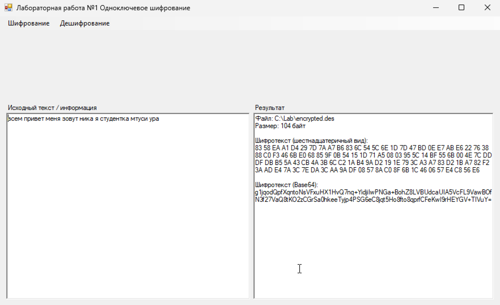
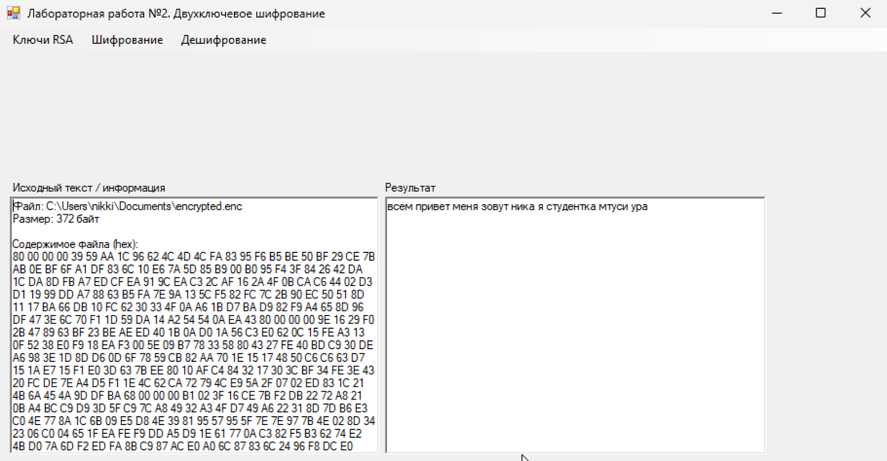
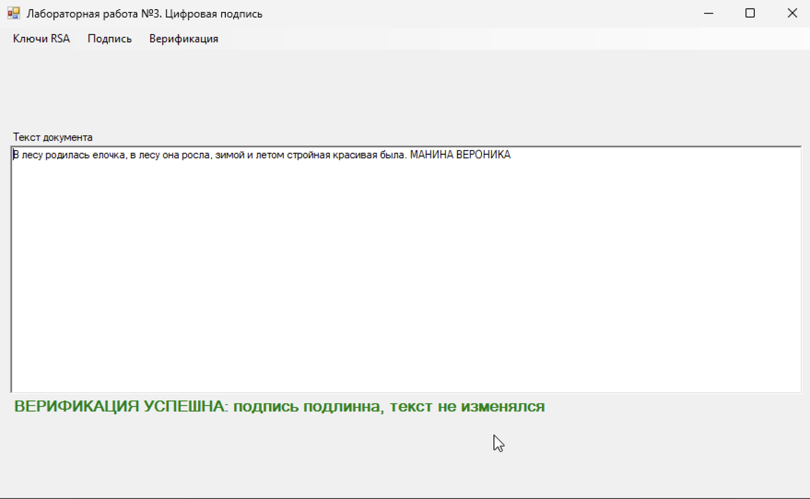
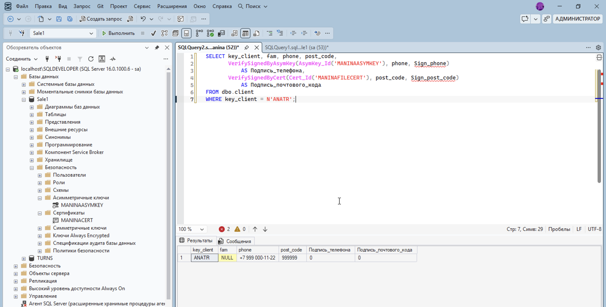

### 🔐 защита данных · data security labs

лабораторные по курсу «защита данных в бизнес-системах» (мтуси, 2026). шифрую файлы на c#, подписываю документы rsa и прячу данные прямо внутри sql server
*university labs on data protection: file encryption in c#, rsa signatures and built-in encryption in sql server*

`c#` `.net` `windows forms` `des` `rsa` `md5` `sql server` `t-sql` `powershell` `openssl`

---

**что внутри** · *what's inside*

| # | лаба · lab | что делает · what it does | стек · stack |
|---|---|---|---|
| 01 | [одноключевое шифрование](01-des-symmetric/Form1.cs) | создаёт ключ des, шифрует и расшифровывает файл, показывает инфу о ключе | c#, des |
| 02 | [двухключевое шифрование](02-rsa-hybrid/Form1.cs) | гибридная схема: текст шифруется одноразовым ключом des, а сам ключ — открытым ключом rsa | c#, rsa + des |
| 03 | [цифровая подпись](03-digital-signature/Form1.cs) | подписывает текст секретным ключом и проверяет подпись открытым | c#, rsa + md5 |
| 04 | [шифрование в sql server](04-sql-symmetric-encryption/encryption.sql) | шифрует столбцы с контактами клиентов симметричным ключом | t-sql |
| 05 | [сертификаты в sql server](05-sql-certificates/) | шифрует данные сертификатом, переносит сертификат из windows в базу | t-sql, powershell, openssl |
| 06 | [цифровая подпись в sql server](06-sql-digital-signature/signature.sql) | заверяет данные подписью и ловит момент, когда их подменили | t-sql |

---

**01 · des: шифруем файл** · *encrypting a file with des*

слева исходный текст и параметры ключа, справа шифротекст
*plain text and key info on the left, ciphertext on the right*

**02 · rsa + des: гибридное шифрование** · *hybrid encryption*

rsa медленный и шифрует только короткие данные, поэтому им закрывается только ключ des, а сам текст шифрует des. так устроены и настоящие протоколы, например tls
*rsa is slow and handles only short data, so it encrypts just the des key while des encrypts the text. real protocols like tls work the same way*

**03 · цифровая подпись** · *digital signature*

если поменять в тексте хоть одну букву, проверка не проходит. а подписать документ открытым ключом программа просто не даст
*change a single letter and verification fails. signing with a public key is blocked*

**04–06 · sql server**

зашифрованные столбцы хранятся как `varbinary`, прочитать их можно только открыв ключ. в шестой лабе после подмены телефона и индекса функция проверки возвращает 0
*encrypted columns are stored as `varbinary` and readable only with the key open. in lab 6, after the phone and post code are changed, verification returns 0*

больше скриншотов в папке [screenshots](screenshots/)
*more screenshots in [screenshots](screenshots/)*

---

**как запустить** · *how to run*

**01–03:** создайте проект windows forms (.net framework) в visual studio, соберите форму из меню и двух полей `RichTextBox` (в 03 ещё `Label` с именем `lblStatus`), добавьте `OpenFileDialog` и `SaveFileDialog` и замените код формы на `Form1.cs`. обработчики привязываются к пунктам меню в дизайнере
*create a windows forms (.net framework) project, add a menu, two `RichTextBox` controls (plus a `Label` named `lblStatus` in lab 3), `OpenFileDialog` and `SaveFileDialog`, then replace the form code with `Form1.cs` and wire the menu handlers in the designer*

**04–06:** скрипты рассчитаны на учебную базу `Sale1`, которую давали на курсе. перед запуском подставьте свои пароли вместо `<KEY_PASSWORD>` и других плейсхолдеров
*scripts target the `Sale1` training database from the course. replace `<KEY_PASSWORD>` and other placeholders with your own passwords*

---

**важно** · *note*

это учебные работы. des и md5 сегодня считаются устаревшими и взламываются, в реальных проектах вместо них используют aes и sha-256. зато на них хорошо видно, как устроено шифрование
*these are study projects. des and md5 are outdated and breakable; real systems use aes and sha-256. they're still great for learning how encryption works*
